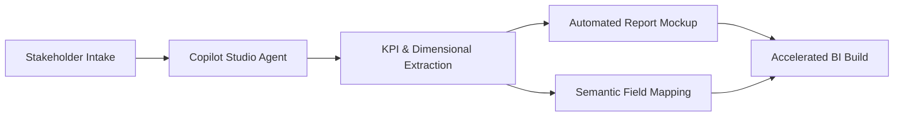
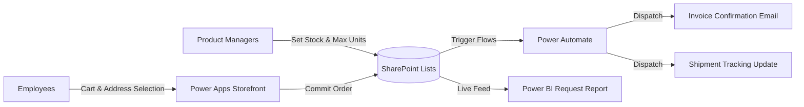

# SHAMIKA BALLARD
**EXECUTIVE BI & AI ARCHITECT — DATA GOVERNANCE, SEMANTIC MODELING & INTELLIGENT AUTOMATION**

*Bridging enterprise data strategy, governed semantic architecture, and AI-driven automation to turn complex data ecosystems into measurable business ROI.*

 

<!-- SECTION 1: SYMMETRICAL 3-COLUMN EXECUTIVE SCORECARD -->
<table width="100%">
  <tr>
    <td width="33%" align="center" valign="top">
      <h3>15+ YEARS</h3>
      <b>ENTERPRISE BI & ARCHITECTURE</b>
        
      Transforming complex enterprise data ecosystems into governed decision intelligence and executive reporting.
    </td>
    <td width="33%" align="center" valign="top">
      <h3>~40% FASTER</h3>
      <b>AI-ACCELERATED BI DELIVERY</b>
        
      Compressing requirements-to-mockup lifecycles using structured Microsoft Copilot Studio agents.
    </td>
    <td width="33%" align="center" valign="top">
      <h3>END-TO-END</h3>
      <b>SEMANTIC & LOW-CODE SYSTEMS</b>
        
      Unifying certified Power BI semantic layers with automated Power Platform operational workflows.
    </td>
  </tr>
</table>

<!-- SECTION 2: BALANCED 50/50 MANDATE & TECHNOLOGY MATRIX -->
<table width="100%">
  <tr>
    <td width="50%" valign="top">
      <h3>ARCHITECTURAL MANDATE</h3>
      

        Enterprise AI is only as reliable as the governance and semantic layer beneath it. I partner with executive leadership and engineering teams to standardize BI administration, architect certified semantic models, and deploy AI agents that deliver measurable operational ROI.
      

      <ul>
        <li><b>AI-Ready Governance:</b> Centralized access oversight, RLS, and certified semantic layers prior to scaling AI.</li>
        <li><b>Agentic Orchestration:</b> Automated requirements intake and mockup generation via Copilot Studio.</li>
        <li><b>Workflow Automation:</b> Full-lifecycle Power Platform applications connecting intake to live reporting.</li>
      </ul>
    </td>
    <td width="50%" valign="top">
      <h3>CORE TECHNOLOGY MATRIX</h3>
      

        <b>BI ARCHITECTURE & SEMANTIC LAYER</b> 
        
         
        
        
      

      

        <b>AI AGENTS & POWER PLATFORM ECOSYSTEM</b> 
        
         
        
        
      

      

        <b>ENTERPRISE ADMINISTRATION & STRATEGY</b> 
        
        
      

    </td>
  </tr>
</table>

 

## ARCHITECTURAL CASE STUDIES

<!-- SECTION 3: UNIFORM 2-COLUMN CASE STUDY LEDGER (NO NESTED TABLES) -->
<table width="100%">
  <tr>
    <td width="32%" valign="top">
      <kbd>INITIATIVE 01</kbd>
      <h4>Copilot Studio Agent: Requirements-to-Mockup</h4>
      

        
      

      <b>STACK:</b> Copilot Studio · Power BI · Prompt Engineering
    </td>
    <td width="68%" valign="top">
      
<b>Challenge:</b> Traditional BI requirements gathering relied on fragmented stakeholder interviews and manual wireframing, creating multi-week bottlenecks prior to development.

      
<b>Architecture:</b> Engineered a Microsoft Copilot Studio agent that guides business stakeholders through structured requirements intake and automatically translates functional needs into standardized report mockups and metric specifications.

      
<b>Outcome:</b> Compressed end-to-end BI delivery timelines by <b>~40%</b> and eliminated scope misalignment between stakeholders and data engineering.

    </td>
  </tr>
  <tr>
    <td width="32%" valign="top">
      <kbd>INITIATIVE 02</kbd>
      <h4>BI Governance & Semantic Architecture Ahead of AI</h4>
      

        
      

      <b>STACK:</b> Power BI Semantic Models · RLS · Access Policy
    </td>
    <td width="68%" valign="top">
      
<b>Challenge:</b> Deploying conversational AI and self-service analytics on top of siloed reports and ungoverned datasets introduces conflicting KPIs and security exposure.

      
<b>Architecture:</b> Established a centralized BI governance framework ahead of AI rollout. Enforced manager-approved access provisioning workflows, role-based security (RLS), and certified Power BI semantic models.

      
<b>Outcome:</b> Delivered an audit-ready analytics foundation capable of supporting both executive self-service and reliable AI agent queries.

    </td>
  </tr>
  <tr>
    <td width="32%" valign="top">
      <kbd>INITIATIVE 03</kbd>
      <h4>Product Sampling & Automated Fulfillment</h4>
      

        
      

      <b>STACK:</b> SharePoint Lists · Power Apps · Power Automate · Power BI
    </td>
    <td width="68%" valign="top">
      
<b>Challenge:</b> Product Managers lacked real-time control over sample eligibility and unit limits, while employee ordering, shipping selection, invoicing, and tracking updates required manual follow-ups.

      
<b>Architecture:</b> Built an integrated four-stage fulfillment system across the Microsoft Power Platform:

      <ol>
        <li><b>Inventory Control (SharePoint Lists):</b> Product Managers govern active sample availability and enforce maximum unit caps per item.</li>
        <li><b>Cart & Checkout (Power Apps):</b> Employees add eligible products to cart and select Home Office or Residential shipping addresses.</li>
        <li><b>Event Automation (Power Automate):</b> Automated workflows dispatch instant invoice confirmations at checkout and tracking updates upon shipment.</li>
        <li><b>Operational Visibility (Power BI):</b> Live reporting suite tracks all historical and active sample requests, inventory burn rates, and fulfillment status.</li>
      </ol>
    </td>
  </tr>
</table>

 

## SYSTEM ARCHITECTURE BLUEPRINTS

  
<b>01 / COPILOT STUDIO REQUIREMENTS-TO-MOCKUP PIPELINE (CLICK TO EXPAND)</b>

   

  
<b>02 / PRODUCT SAMPLING & AUTOMATED FULFILLMENT ARCHITECTURE (CLICK TO EXPAND)</b>

   

  <b>SHAMIKA BALLARD</b> — ENTERPRISE DATA ARCHITECTURE, GOVERNANCE & AI AUTOMATION

